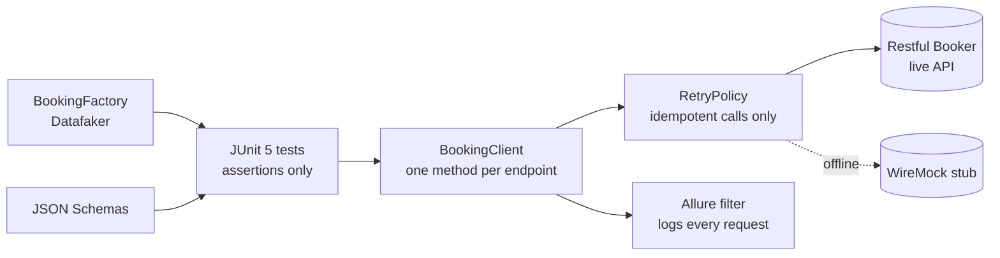

# Java API Test Framework

[](https://github.com/fauzanfzn/java-api-test-framework/actions/workflows/ci.yml)
[](https://fauzanfzn.github.io/java-api-test-framework/)

Backend API test automation in **Java 21 + REST Assured + JUnit 5**, with JSON Schema contracts, WireMock resilience tests and an **Allure** report published on every run.

It tests the public [Restful Booker](https://restful-booker.herokuapp.com/apidoc/index.html) API, a booking service with token auth and full CRUD, so anyone can clone it and run it.

**Live report:** https://fauzanfzn.github.io/java-api-test-framework/

## What it shows

| Area | How | Where |
| --- | --- | --- |
| Full CRUD lifecycle | create → read → PUT → PATCH → delete → 404, as Allure steps | `BookingLifecycleTest` |
| Auth and authorization | data-driven bad credentials; every write rejected without a valid token, and data proven unchanged | `AuthTest`, `BookingSecurityTest` |
| Response contracts | JSON Schema validation on create and read | `BookingContractTest`, `src/test/resources/schemas` |
| Client resilience (offline) | WireMock: retry on transient 503, give up after N attempts, never retry 4xx, never retry POST (no duplicate bookings), exact headers + cookie sent | `ClientResilienceTest` |
| Test data | unique, realistic bookings from Datafaker, so parallel runs never collide | `BookingFactory` |
| Reporting | Allure (request/response attached to every call) + readiness % in the GitHub job summary | `scripts/summary.py` |
| CI | GitHub Actions on push, PR and daily schedule; quality gate fails the build on any defect | `.github/workflows/ci.yml` |

## Design



- **Client has no assertions; tests have no HTTP plumbing.** Swapping the base URL (`API_BASE_URI`) points the same suite at another environment.
- **Retries only where they are safe.** GETs retry on 5xx/network errors with back-off; POST is never retried, and a WireMock test proves it.
- **Tags split the suite:** `mock` runs offline in seconds, `live` needs the API.

## Run it

```bash
mvn test                      # everything
mvn test -Dgroups=mock        # offline only (no network)
mvn test -Dgroups=live        # live API only
mvn allure:serve              # open the Allure report locally
```

Configuration (env var or `-D` property): `API_BASE_URI`, `API_USERNAME`, `API_PASSWORD`, `API_TIMEOUT_SECONDS`, `API_MAX_ATTEMPTS`.

## Related

- [ai-qa-automation-framework](https://github.com/fauzanfzn/ai-qa-automation-framework): Playwright + TypeScript framework with UI, API contract, visual and LLM evaluation tests.
- Portfolio: [fauzanfzn.github.io](https://fauzanfzn.github.io)

---
Built by [Muhammad Nur Fauzan](https://www.linkedin.com/in/mnurfauzan-qa), QA Automation Engineer / SDET.
